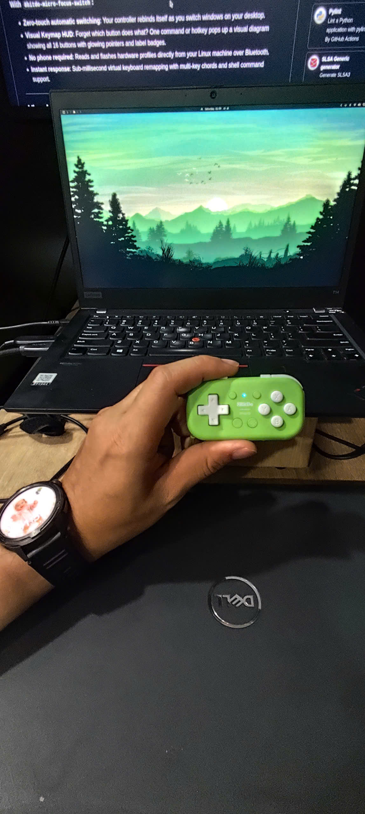
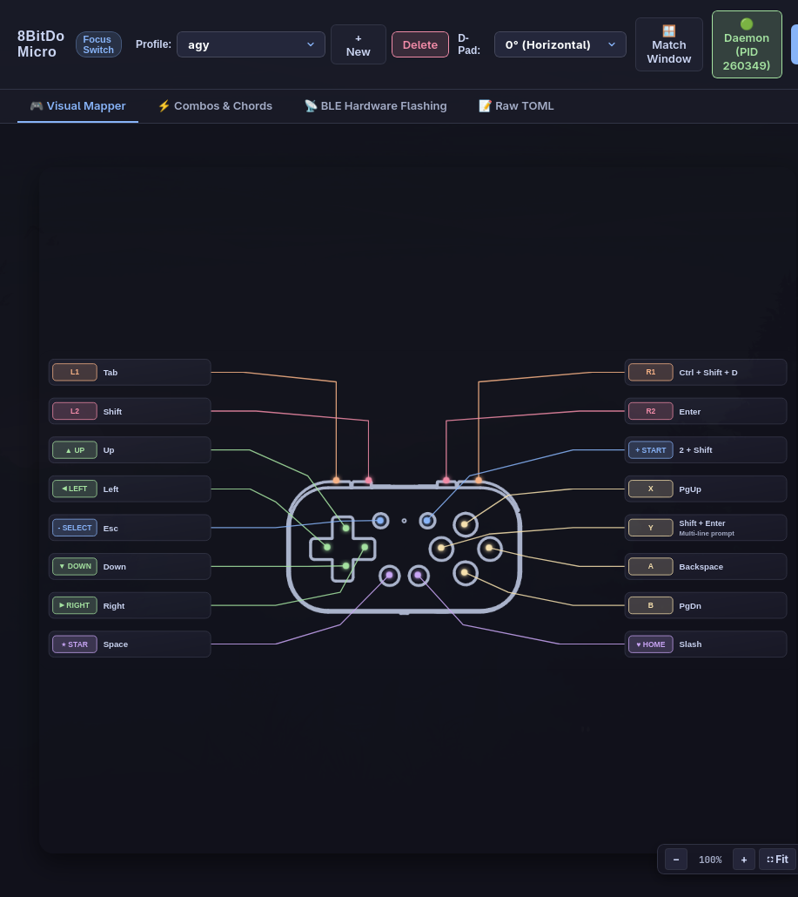
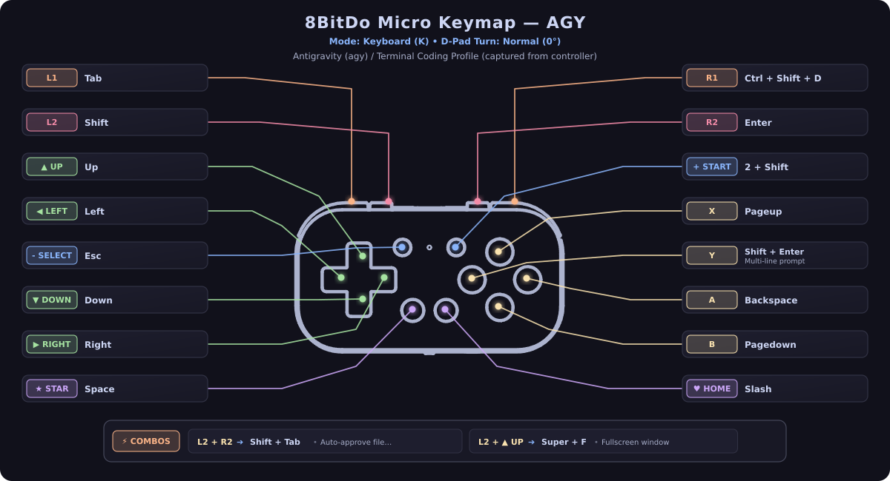

<p align="right">
  <b>English</b> • <a href="README.vn.md">Tiếng Việt</a>
</p>

# 8bitdo-micro-focus-switch

A lightweight Linux tool (with experimental macOS and Windows support) that automatically switches button mappings on your **8BitDo Micro** and **8BitDo Zero 2** depending on which application window is currently active.

---

## Why?

<p align="center">
  
</p>

I originally bought an 8BitDo Micro to play retro games with RetroArch on Omarchy (I'm a newcomer to Omarchy and custom Linux window managers).

Pretty quickly, I realized this tiny controller could make a great one-handed shortcut pad for terminal work and CLI AI assistants like Claude Code and Antigravity CLI (`agy`), as well as everyday tasks like navigating YouTube, media players, or reviewing Anki flashcards.

The frustrating part with the standard setup was the static profile: the controller only keeps one layout at a time. If I was coding in a terminal and wanted to switch over to YouTube or Anki, I had to disconnect Bluetooth, pull out a phone, re-flash the key mappings in the companion app, and reconnect. Doing that multiple times a day got annoying fast.

I wanted something that runs quietly in the background, tracks whatever window I currently have in focus, and switches the button mappings on the fly — with zero manual fiddling, no phone, and no Bluetooth disconnects.

Along the way, I also added:
- Support for the 8BitDo Zero 2 (which sends the same factory keyboard characters).
- Multi-button combos (like `L1 + R1` for your application launcher or command palette).
- D-pad rotation (`turn = 90`) for holding the controller vertically in one hand.
- An interactive visual HUD to quickly remind yourself what each button does in the active app.

---

## Built-in Profiles

Out of the box, `8bitdo-micro-focus-switch` comes configured with handy defaults for popular apps:

| Profile | Trigger Window | What the buttons do |
| :--- | :--- | :--- |
| **`agy`** *(default)* | Terminal / Ghostty / Alacritty | `Shift+Enter` (new line), `Enter`, `@` (files), `/` (commands), `Backspace`, `PageUp/Down` |
| **`youtube`** | Browser watching YouTube | `Space` (play/pause), `M` (mute), `F` (fullscreen), `C` (captions), `J`/`L` (±10s seek), `Shift+,`/`Shift+.` (speed), `Shift+N` (next video) |
| **`anki`** | Anki Flashcards | `1` (Again), `2` (Good), `4` (Easy), `Space` (Show answer), `Ctrl+Shift+D`, `Ctrl+Alt+N`, `Ctrl+Z` |
| **`browser`** | Firefox, Chromium, Zen, Brave | `PageUp/Down`, `Space`, `Ctrl+T` (new tab), `Ctrl+W` (close), `Ctrl+Shift+T` (reopen), Tab switching |
| **`media`** | VLC, MPV | `Space` (play/pause), `F` (fullscreen), `M` (mute), `[` / `]` (speed), `9` / `0` (volume) |
| **`factory`** | Any | Clean single scancodes (`c` through `t`) on all buttons |

---

## Quick Start

### 1. Installation & One-Step Setup

`8bitdo-micro-focus-switch` is a single, self-contained native binary built in Rust with Tauri v2. It requires **zero external runtime dependencies**.

#### Download Pre-Built Binary / Package
Download the latest pre-built package for your platform from [Releases](https://github.com/DinuPhan/8bitdo-micro-focus-switch/releases):
- **Linux**: `.deb`, `.AppImage`, or standalone binary `8bitdo-micro-focus-switch`
- **Windows**: `.msi` installer or `8bitdo-micro-focus-switch.exe`
- **macOS**: `.dmg` (Universal Apple Silicon & Intel)

#### Or Build from Source
```bash
git clone https://github.com/DinuPhan/8bitdo-micro-focus-switch.git
cd 8bitdo-micro-focus-switch/gui
npm install && npm run build
cargo build --release --manifest-path src-tauri/Cargo.toml
cp src-tauri/target/release/8bitdo-micro-focus-switch ~/.local/bin/
```

#### One-Step Setup (Linux)
Run `setup` to automatically create the default `profiles.toml`, configure `/dev/uinput` permissions, and enable + start the background systemd service:

```bash
8bitdo-micro-focus-switch setup
```

### 2. Connect Your Controller (Bluetooth Keyboard Mode)

Both controllers must be paired in **Keyboard Mode** so the daemon can intercept and dynamically remap button inputs:

| Controller | Power On / Mode Selection | Enter Pairing Mode | Device Name in OS | Status LED |
| :--- | :--- | :--- | :--- | :--- |
| **8BitDo Micro** | Slide bottom switch to **`K`** | Hold bottom **Pair** button for 3s | `8BitDo Micro gamepad Keyboard` | Blue LED blinks rapidly |
| **8BitDo Zero 2** | Hold **`R + START`** to power on | Hold **`SELECT`** button for 3s | `8BitDo Zero 2 gamepad` | Blue LED blinks rapidly (5 blinks/cycle when idle) |

#### Quick Pairing Steps:
1. **Power on in Keyboard mode** as shown in the table above.
2. **Hold the pair button** for 3 seconds until the blue LED flashes rapidly.
3. **Select the controller** in your system Bluetooth menu (GNOME, KDE, `blueman`, or `bluetoothctl`).
4. **Done!** The background daemon automatically detects the controller (`model=8BitDo Micro` or `model=8BitDo Zero 2`) and begins remapping with `<1ms` latency.

> [!TIP]
> **Subsequent Connections**: After pairing once, simply tap **`START`** (Zero 2) or flick to **`K`** (Micro) to wake the controller. It reconnects to your computer automatically, and the daemon re-attaches instantly with zero manual intervention.

### 3. Check Status

```bash
# Verify your controller is connected and see the active profile:
8bitdo-micro-focus-switch status

# Or preview your keymap layout visually:
8bitdo-micro-focus-switch show
```

---

## Desktop Graphical App (Unified GUI & System Tray)

Prefer a visual interface over terminal commands? The single unified binary includes both the CLI and the desktop GUI:

- Run `8bitdo-micro-focus-switch` (with no arguments or via application launcher) to open the GUI.
- Run `8bitdo-micro-focus-switch [subcommand]` (e.g. `status`, `bind`, `show`, `ble`) to run as a CLI tool in your terminal.

<p align="center">
  
</p>

- **In-Process Daemon**: When running the GUI, the background focus switch daemon runs directly in-process with system tray controls (minimize to tray, quick reload, toggle).
- **Visual Mapper**: Interactive controller contour with real-time callouts for every profile.
- **Combos & Chords Editor**: Configure multi-button hotkeys with intuitive pickers.
- **Active Window Auto-Matching**: Detects the focused window with one click to bind profiles.
- **Live Daemon Status**: Shows real-time connection status of the background focus switcher.
- **Native Hardware Flasher**: Reads and writes 8BitDo Micro onboard memory over BLE GATT directly without external dependencies.

Pre-built Linux packages (`.AppImage`, `.deb`) are available on [Releases](https://github.com/DinuPhan/8bitdo-micro-focus-switch/releases). Experimental builds for macOS (`.dmg`) and Windows (`.msi`, `.exe`) are also provided for testing and feedback.

> [!NOTE]
> **Platform Status**: Linux (Hyprland / `evdev` / `uinput`) is the primary, battle-tested platform where this tool was created. Windows and macOS support is currently **experimental / in active development** and has not been fully verified across all window managers — testing and feedback are very welcome!

---

## Visual Keymap Diagram & HUD

Pressing buttons shouldn't feel like a memory test. You can display your active keymap at any time:

<p align="center">
  
</p>

```bash
# Auto-detects your active window and pops up its controller keymap:
8bitdo-micro-focus-switch show

# View a specific profile diagram (e.g. YouTube, AGY, Anki):
8bitdo-micro-focus-switch show youtube
8bitdo-micro-focus-switch show agy

# Open an interactive viewer in your browser with tabs for every profile:
8bitdo-micro-focus-switch show --interactive

# Save as a self-contained SVG or PNG:
8bitdo-micro-focus-switch show youtube -o youtube_keymap.svg
8bitdo-micro-focus-switch show agy --format png -o agy_keymap.png
```

### In-Game Style HUD on Hyprland

Add this to your `~/.config/hypr/hyprland.conf` to pop up a floating keymap HUD whenever you press `Super+M`:

```hyprlang
# Floating overlay window for the keymap diagram
windowrulev2 = float, class:^(imv)$, title:^(8bitdo-micro.*)
bind = $mainMod, M, exec, 8bitdo-micro-focus-switch show --no-wait
```

---

## Daily Commands

These are the primary commands you will use daily:

```bash
# 1. Preview your key mappings as an interactive visual HUD:
8bitdo-micro-focus-switch show

# 2. Interactively bind a button by pressing your keyboard (no typing required!):
8bitdo-micro-focus-switch bind
8bitdo-micro-focus-switch bind agy A
8bitdo-micro-focus-switch bind agy "L+R"

# 3. Browse or search bindable keys catalog:
8bitdo-micro-focus-switch keys
8bitdo-micro-focus-switch keys volume

# 4. Listen and inspect keyboard chords in real-time:
8bitdo-micro-focus-switch record

# 5. Edit or customize an app profile in your editor:
8bitdo-micro-focus-switch config agy
8bitdo-micro-focus-switch config spotify

# 6. Reload profiles into the running daemon (zero downtime, no disconnect):
8bitdo-micro-focus-switch reload

# 7. Check focus status and connected controllers:
8bitdo-micro-focus-switch status

# 8. Scan for nearby controllers:
8bitdo-micro-focus-switch discover
```

---

## Interactive Key Binder (`bind`), Recorder (`record`), & Catalog (`keys`)

### 1. Interactive Key Binder (`bind`)
Simply press the shortcut on your physical keyboard:

```bash
# Interactive wizard: detects active window, asks for button, and waits for keypress:
8bitdo-micro-focus-switch bind

# Bind a specific button or combo directly:
8bitdo-micro-focus-switch bind agy A
8bitdo-micro-focus-switch bind agy "L+R"
```
1. It waits: `>> Listening for keyboard input for [agy.A]... Press any key or combination (ESC to cancel):`
2. Press `Ctrl+Shift+P` (or `Space`, `Super+K`, `PageUp`) on your keyboard.
3. It detects the chord, saves it to `~/.config/8bitdo-micro/profiles.toml`, and sends a zero-downtime `SIGHUP` reload signal to the running daemon.
4. **Discard with `ESC`**: Pressing `ESC` at any time cancels without saving.

### 2. Live Chord Recorder (`record`)
Press keys on your keyboard to inspect their exact chord names and TOML representations:
```bash
8bitdo-micro-focus-switch record
```

### 3. Bindable Keys Catalog (`keys`)
Browse all supported keys categorized into Modifiers, Navigation, Actions, Media & Volume, Function Keys, and Symbols:
```bash
# View complete categorized catalog:
8bitdo-micro-focus-switch keys

# Search for specific keys:
8bitdo-micro-focus-switch keys media
8bitdo-micro-focus-switch keys volume
```

---

## Customizing Mappings in Editor (`config`)

All profiles live in `~/.config/8bitdo-micro/profiles.toml`. You can manage and edit your profiles easily:

```bash
# 1. Open the configuration file in your editor ($EDITOR or Neovim):
8bitdo-micro-focus-switch config

# 2. Jump directly to an existing profile:
8bitdo-micro-focus-switch config youtube
8bitdo-micro-focus-switch config agy

# 3. Add a new app profile (e.g. Spotify, Discord, VS Code):
8bitdo-micro-focus-switch config spotify
# -> If the profile doesn't exist yet, it asks to create it, generates a starter
#    template with all buttons, merges it into profiles.toml,
#    and opens your editor directly at the new section!

# 4. List all configured profiles with line numbers:
8bitdo-micro-focus-switch config --list

# 5. Reload the running daemon immediately (zero downtime):
8bitdo-micro-focus-switch reload
```

### Profile Example

A profile looks like this:

```toml
[profiles.spotify]
description = "Spotify Music Controller"
match_class = "spotify"           # Regex matched against window class (from compositor/OS)
turn = 0                          # 0 = normal horizontal, 90 = held vertically

# Button mappings (use friendly names or chords with "+"):
A = "Space"                       # Play / Pause
B = "M"                           # Mute
X = "Ctrl+Right"                  # Next Track
Y = "Ctrl+Left"                   # Previous Track
L = "Ctrl+Down"                   # Volume Down
R = "Ctrl+Up"                     # Volume Up
SELECT = "Esc"
START = "exec:playerctl play-pause" # You can also run shell commands!
STAR = "None"
HOME = "Super"
UP = "Up"
DOWN = "Down"
LEFT = "Left"
RIGHT = "Right"
```

> **Inline Descriptions & Tooltips**: Single-line comments (e.g. `# Play / Pause`) written inline with button or combo mappings are automatically parsed and displayed as visual subtitles and interactive hover tooltips in `show` keymap diagrams.

### Button Names Reference

- **8BitDo Micro (16 buttons)**:
  - **Face buttons**: `A`, `B`, `X`, `Y`
  - **Shoulders / Bumpers**: `L` (L1), `R` (R1), `L2`, `R2`
  - **Center**: `SELECT` (`-`), `START` (`+`)
  - **Bottom**: `STAR` (★), `HOME` (♥)
  - **D-pad**: `UP`, `DOWN`, `LEFT`, `RIGHT`

- **8BitDo Zero 2 (12 buttons)**:
  - Features the same 12 core buttons: `A`, `B`, `X`, `Y`, `L`, `R`, `SELECT`, `START`, and `UP`, `DOWN`, `LEFT`, `RIGHT`.
  - *(Zero 2 does not have physical L2, R2, STAR, or HOME buttons).*

### Holding the Controller Vertically (`turn = 90`)

If you like holding the controller vertically in one hand (e.g. for reading or flashcards), set `turn = 90` in your profile. The D-pad automatically rotates so physical "Up" continues pointing in the direction you expect.

### Matching Web Apps & PWAs (e.g. YouTube, Notion, Spotify)

When running apps installed via Chrome, Chromium, or Brave (Progressive Web Apps), browsers set window classes like `chrome-youtube.com__-Profile_3`.

You can match either using `match_rules` (for multiple OR conditions) or regexes:

```toml
[profiles.youtube]
description = "YouTube Video Playback in Browser or Standalone Web App"
match_rules = [
    { class = ".*youtube.*|freetube" },
    { class = "^(firefox|brave-browser|chromium|google-chrome|zen|vivaldi-stable)$", title = ".*(YouTube|- YouTube).*" },
]
```

### Multi-Button Combos & Chording (e.g. L1 + R1 -> Super + K)

You can map simultaneous button presses (chords) into hotkeys or shell commands! When defined, pressing both buttons within ~40ms suppresses the individual button actions and fires your combo hotkey instead:

```toml
[profiles.agy.combos]
"L+R" = ["Super", "K"]               # L1 + R1 -> Super + K (Command palette / app launcher)
"Select+Start" = "exec:notify-send 'Micro' 'Hello!'"
"L2+R2" = ["Ctrl", "Shift", "P"]
```

- **Simultaneous & Hold-and-Press**: Supports both simultaneous chording (~50ms) and holding a button as a modifier (e.g. holding `L2` while tapping `LEFT`).
- **Zero-Latency Solo Buttons**: Buttons that are not part of any combo fire immediately with `0ms` delay.
- **Fast Tap Guarantee**: Tapping a combo button quickly will still register its solo key instantly upon release.
- **Visual Diagram Integration**: Configured combos appear as dedicated glowing badges at the bottom of the visual keymap.

### Global Base Combos (`[profiles.global]` or `[profiles.all]`)

Want a combo to work everywhere across all apps without copy-pasting it into every profile? Define it under `[profiles.global.combos]`:

```toml
[profiles.global.combos]
"L+R" = ["Super", "K"]               # L1 + R1 -> Super + K (Works in every app!)
"Select+Start" = "exec:hyprctl dispatch togglespecialworkspace"
```

- **Inherited by Default**: All profiles (`agy`, `anki`, `youtube`, `browser`, etc.) automatically inherit these combos.
- **Profile Overrides**: If an individual profile defines its own combo (e.g., `[profiles.youtube.combos] "L+R" = "F"`), that specific profile's combo takes precedence over the global default.

---

## Direct Hardware Flasher (8BitDo Micro Only)

If you prefer to flash a profile directly into the 8BitDo Micro's onboard memory (so it stays even if you plug into another computer without this tool installed):

```bash
# Flash any profile directly over Bluetooth:
8bitdo-micro-focus-switch ble write youtube
8bitdo-micro-focus-switch ble write agy
8bitdo-micro-focus-switch ble write anki --turn 90

# Reset controller back to factory keys:
8bitdo-micro-focus-switch ble reset
```

---

## Setup Commands

### `setup` (All-in-One Setup)

```bash
8bitdo-micro-focus-switch setup
```

Automatically creates `~/.config/8bitdo-micro/profiles.toml` (with built-in app profiles and global Omarchy chords), installs the `/dev/uinput` udev rule if needed, and enables + starts `8bitdo-micro-focus-switch.service` via `systemd --user`.

Individual setup steps can also be run separately if needed:
- `8bitdo-micro-focus-switch install-udev` — install `/dev/uinput` udev rule
- `8bitdo-micro-focus-switch install-service` — write, enable, and start `8bitdo-micro-focus-switch.service`

---

## Disclaimer

This is an independent, community-driven open-source project. It is not affiliated with, endorsed by, sponsored by, or in any way officially connected with Shenzhen 8BitDo Tech Co., Ltd. (8BitDo) or any of its subsidiaries or affiliates.

The names "8BitDo", "8BitDo Micro", and "8BitDo Zero 2" as well as related trade names, trademarks, and logos are the property of their respective owners and are used here solely for technical identification, compatibility, and interoperability purposes.

The Bluetooth Low Energy (BLE) GATT configuration protocol used by the 8BitDo Micro was analyzed independently for personal interoperability and open-source tooling. This software is provided "as is", without warranty of any kind, express or implied, including but not limited to the warranties of merchantability, fitness for a particular purpose, and noninfringement. In no event shall the authors or copyright holders be liable for any claim, damages, or other liability arising from, out of, or in connection with the software or the use or other dealings in the software.

---

## License

[MIT](LICENSE) © Nguyen Dinh Phan
