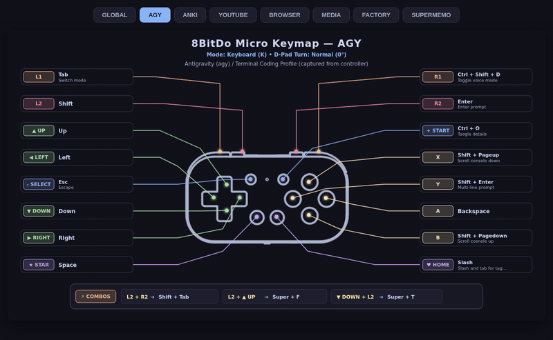

<p align="right">
  <a href="README.md">English</a> • <b>Tiếng Việt</b>
</p>

# 8bitdo-micro-focus-switch

Một công cụ gọn nhẹ cho Linux (đang thử nghiệm hỗ trợ thêm macOS và Windows) giúp tự động đổi keymap (gán phím) trên tay cầm **8BitDo Micro** và **8BitDo Zero 2** tùy theo cửa sổ ứng dụng mà bạn đang mở trên màn hình.

---

## Tại sao mình làm dự án này?

<p align="center">
  
</p>

Ban đầu, mình mua chiếc 8BitDo Micro chỉ đơn giản là để chơi game retro với RetroArch trên Omarchy (mình cũng là một người mới làm quen với Omarchy và các window manager trên Linux).

Nhưng rất nhanh sau đó, mình nhận ra chiếc tay cầm tí hon này hoàn toàn có thể trở thành một chiếc bàn phím shortcut một tay tuyệt vời: từ gõ lệnh trong terminal, điều khiển các công cụ CLI AI như Claude Code hay Antigravity CLI (`agy`), cho đến những nhu cầu giải trí hằng ngày như lướt YouTube, điều khiển nhạc, hay bấm thẻ flashcard trên Anki.

Tuy nhiên, rào cản khó chịu nhất khi dùng chế độ mặc định của hãng là profile phím bị tĩnh: chiếc tay cầm chỉ lưu được đúng một layout duy nhất. Mỗi lần mình đang gõ code trong terminal mà muốn chuyển sang xem video YouTube hay học Anki, mình lại phải ngắt kết nối Bluetooth, lôi điện thoại ra, mở app đổi phím rồi nạp lại, sau đó kết nối Bluetooth lại vào máy tính. Một ngày lặp đi lặp lại việc đó vài lần thôi là thấy nản vô cùng.

Vì vậy, mình quyết định viết một công cụ chạy nền êm ái: nó tự động phát hiện xem bạn đang focus vào cửa sổ nào trên màn hình, rồi tức tốc tráo đổi các gán phím tương ứng trong chớp mắt — bạn không cần phải làm gì thủ công, không cần đụng đến điện thoại, và tuyệt đối không bao giờ phải ngắt kết nối Bluetooth.

Trong quá trình phát triển, mình cũng tiện tay bổ sung thêm:
- Hỗ trợ cả 8BitDo Zero 2 (chiếc tay cầm này cũng gửi các ký tự phím mặc định tương tự).
- Hỗ trợ tổ hợp phím đa nút (combos / chords, ví dụ bấm `L1 + R1` cùng lúc để bật app launcher hoặc command palette).
- Hỗ trợ xoay hướng phím D-pad (`turn = 90`) khi bạn cầm dọc tay cầm bằng một tay.
- Giao diện HUD trực quan hiển thị ngay sơ đồ phím để bạn không cần phải căng não nhớ xem nút nào đang làm nhiệm vụ gì.

---

## Các Profile có sẵn

Ngay khi cài đặt xong, `8bitdo-micro-focus-switch` đã được cấu hình sẵn các profile tiện lợi cho những ứng dụng phổ biến:

| Profile | Cửa sổ kích hoạt | Chức năng các nút bấm |
| :--- | :--- | :--- |
| **`agy`** *(mặc định)* | Terminal / Ghostty / Alacritty | `Shift+Enter` (xuống dòng), `Enter`, `@` (chọn file), `/` (lệnh), `Backspace`, `PageUp/Down` |
| **`youtube`** | Trình duyệt đang xem YouTube | `Space` (phát/tạm dừng), `M` (tắt tiếng), `F` (toàn màn hình), `C` (phụ đề), `J`/`L` (tua ±10s), `Shift+,`/`Shift+.` (tốc độ), `Shift+N` (video tiếp) |
| **`anki`** | Thẻ nhớ Anki | `1` (Again), `2` (Good), `4` (Easy), `Space` (Hiện đáp án), `Ctrl+Shift+D`, `Ctrl+Alt+N`, `Ctrl+Z` |
| **`browser`** | Firefox, Chromium, Zen, Brave | `PageUp/Down`, `Space`, `Ctrl+T` (tab mới), `Ctrl+W` (đóng tab), `Ctrl+Shift+T` (mở lại tab), chuyển qua lại giữa các tab |
| **`media`** | VLC, MPV | `Space` (phát/tạm dừng), `F` (toàn màn hình), `M` (tắt tiếng), `[` / `]` (tốc độ), `9` / `0` (âm lượng) |
| **`factory`** | Mọi ứng dụng | Trả về đúng các scancode phím gốc xuất xưởng (`c` đến `t`) trên từng nút |

---

## Bắt đầu nhanh (Quick Start)

### 1. Cài đặt

`8bitdo-micro-focus-switch` là một file thực thi nhị phân (single binary) độc lập viết bằng Rust + Tauri v2, **hoàn toàn không cần bất kỳ dependency runtime bên ngoài nào**.

#### Tải bản cài đặt sẵn
Bạn có thể tải gói cài đặt trực tiếp cho hệ điều hành của mình tại [Releases](https://github.com/DinuPhan/8bitdo-micro-focus-switch/releases):
- **Linux**: `.deb`, `.AppImage`, hoặc binary độc lập `8bitdo-micro-focus-switch`
- **Windows**: Bộ cài `.msi` hoặc file `8bitdo-micro-focus-switch.exe`
- **macOS**: `.dmg` (Universal Apple Silicon & Intel)

#### Hoặc biên dịch từ mã nguồn
```bash
git clone https://github.com/DinuPhan/8bitdo-micro-focus-switch.git
cd 8bitdo-micro-focus-switch/gui
npm install && npm run build
cargo build --release --manifest-path src-tauri/Cargo.toml
cp src-tauri/target/release/8bitdo-micro-focus-switch ~/.local/bin/
```

#### Thiết lập 1 bước (Linux)
Chạy lệnh `setup` để tự động tạo cấu hình `profiles.toml`, cấp quyền `/dev/uinput` và bật service chạy ngầm systemd:
```bash
8bitdo-micro-focus-switch setup
```

### 2. Kết nối tay cầm (Chế độ Keyboard Bluetooth)

Cả hai tay cầm đều cần được ghép nối ở **Chế độ Bàn phím (Keyboard Mode)** để daemon nền có thể bắt tín hiệu và tự động gán lại phím:

| Tay cầm | Bật nguồn / Chọn chế độ | Vào chế độ Pairing | Tên thiết bị trên hệ điều hành | Đèn LED trạng thái |
| :--- | :--- | :--- | :--- | :--- |
| **8BitDo Micro** | Gạt công tắc dưới đáy sang **`K`** | Giữ nút **Pair** dưới đáy 3 giây | `8BitDo Micro gamepad Keyboard` | Đèn xanh dương nhấp nháy nhanh |
| **8BitDo Zero 2** | Giữ **`R + START`** để bật nguồn | Giữ nút **`SELECT`** 3 giây | `8BitDo Zero 2 gamepad` | Đèn xanh dương nhấp nháy nhanh (nhấp nháy 5 lần/chu kỳ khi chờ) |

#### Các bước ghép nối nhanh:
1. **Bật nguồn ở chế độ Keyboard** như bảng hướng dẫn phía trên.
2. **Giữ nút pair** trong 3 giây cho đến khi đèn LED xanh dương nhấp nháy nhanh.
3. **Chọn tay cầm** trong menu Bluetooth của hệ thống (GNOME, KDE, `blueman`, hoặc `bluetoothctl`).
4. **Hoàn tất!** Daemon chạy ngầm sẽ tự động nhận diện tay cầm (`model=8BitDo Micro` hoặc `model=8BitDo Zero 2`) và bắt đầu chuyển đổi phím với độ trễ `<1ms`.

> [!TIP]
> **Những lần kết nối sau**: Sau khi đã ghép nối lần đầu, bạn chỉ cần bấm **`START`** (với Zero 2) hoặc gạt sang **`K`** (với Micro) để đánh thức tay cầm. Tay cầm sẽ tự động kết nối lại vào máy tính, và daemon nền sẽ tự động gắn lại ngay lập tức mà bạn không cần phải làm thêm bất kỳ thao tác nào.

### 3. Kiểm tra trạng thái

```bash
# Kiểm tra xem tay cầm đã kết nối chưa và đang kích hoạt profile nào:
8bitdo-micro-focus-switch status

# Hoặc xem sơ đồ layout phím trực quan:
8bitdo-micro-focus-switch show
```

---

## Ứng dụng giao diện đồ họa (Unified GUI & Khay hệ thống)

Nếu bạn thích một giao diện trực quan bằng chuột hơn là các dòng lệnh terminal, file nhị phân hợp nhất duy nhất cung cấp cả CLI và desktop GUI:

- Chạy `8bitdo-micro-focus-switch` (không kèm tham số hoặc qua App Launcher) để mở giao diện GUI.
- Chạy `8bitdo-micro-focus-switch [subcommand]` (như `status`, `bind`, `show`, `ble`) để chạy như một công cụ dòng lệnh trong terminal.

<p align="center">
  
</p>

- **Daemon chạy ngầm in-process**: Khi mở GUI, tiến trình chuyển đổi phím chạy trực tiếp trong cùng tiến trình và tích hợp khay hệ thống (System Tray).
- **Sơ đồ gán phím trực quan (Visual Mapper)**: Khung vẽ viền tay cầm tương tác với các chú thích thời gian thực cho từng profile.
- **Trình biên tập Combos & Chords**: Cấu hình các tổ hợp phím bấm đồng thời với giao diện chọn phím trực quan.
- **Tự động bắt cửa sổ (Active Window Auto-Matching)**: Tự động nhận diện cửa sổ bạn đang chọn chỉ với một cú click chuột để liên kết profile.
- **Trạng thái Daemon thời gian thực**: Hiển thị kết nối trực tiếp với tiến trình chuyển đổi phím chạy ngầm.
- **Nạp cấu hình phần cứng qua BLE GATT**: Đọc và ghi trực tiếp bộ nhớ onboard của 8BitDo Micro mà không cần bất kỳ công cụ phụ trợ nào.

Các gói cài đặt sẵn cho Linux (`.AppImage`, `.deb`) có sẵn tại mục [Releases](https://github.com/DinuPhan/8bitdo-micro-focus-switch/releases). Các bản dựng thử nghiệm cho macOS (`.dmg`) và Windows (`.msi`, `.exe`) cũng được cung cấp sẵn để bạn trải nghiệm và đóng góp ý kiến.

> [!NOTE]
> **Tình trạng nền tảng**: Linux (Hyprland / `evdev` / `uinput`) là nền tảng chính, nơi công cụ này ra đời và được kiểm thử kỹ lưỡng nhất trong thực tế. Khả năng hỗ trợ Windows và macOS hiện đang ở giai đoạn **thử nghiệm / đang tích cực phát triển (WIP)** và chưa được kiểm thử toàn diện trên tất cả các window manager — mình rất hoan nghênh những đóng góp thử nghiệm và phản hồi từ bạn!

---

## Sơ đồ phím trực quan & HUD

Nhấn phím không nên giống như một bài kiểm tra trí nhớ. Bạn có thể bật sơ đồ layout phím đang dùng bất cứ lúc nào:

<p align="center">
  
</p>

```bash
# Tự động nhận diện cửa sổ đang focus và bật sơ đồ phím tương ứng:
8bitdo-micro-focus-switch show

# Xem sơ đồ của một profile cụ thể (ví dụ: YouTube, AGY, Anki):
8bitdo-micro-focus-switch show youtube
8bitdo-micro-focus-switch show agy

# Mở trình xem tương tác trên trình duyệt với các tab cho từng profile:
8bitdo-micro-focus-switch show --interactive

# Xuất sơ đồ ra file ảnh vector SVG hoặc PNG:
8bitdo-micro-focus-switch show youtube -o youtube_keymap.svg
8bitdo-micro-focus-switch show agy --format png -o agy_keymap.png
```

### Cửa sổ nổi HUD kiểu In-Game trên Hyprland

Thêm dòng sau vào file `~/.config/hypr/hyprland.conf` để bật nhanh bảng HUD sơ đồ phím nổi bất cứ khi nào bạn nhấn `Super+M`:

```hyprlang
# Cửa sổ overlay nổi hiển thị sơ đồ phím
windowrulev2 = float, class:^(imv)$, title:^(8bitdo-micro.*)
bind = $mainMod, M, exec, 8bitdo-micro-focus-switch show --no-wait
```

---

## Các lệnh sử dụng hằng ngày (Daily Commands)

Dưới đây là những lệnh chính mà bạn sẽ thường xuyên sử dụng:

```bash
# 1. Xem trước layout phím dưới dạng sơ đồ HUD trực quan:
8bitdo-micro-focus-switch show

# 2. Gán phím trực quan bằng cách bấm phím thật trên bàn phím (không cần gõ chữ!):
8bitdo-micro-focus-switch bind
8bitdo-micro-focus-switch bind agy A
8bitdo-micro-focus-switch bind agy "L+R"

# 3. Duyệt hoặc tìm kiếm danh mục các phím có thể gán:
8bitdo-micro-focus-switch keys
8bitdo-micro-focus-switch keys volume

# 4. Lắng nghe và kiểm tra tổ hợp phím theo thời gian thực:
8bitdo-micro-focus-switch record

# 5. Mở và chỉnh sửa profile ứng dụng trong text editor yêu thích:
8bitdo-micro-focus-switch config agy
8bitdo-micro-focus-switch config spotify

# 6. Nạp lại cấu hình vào daemon đang chạy (tức thì, không cần ngắt kết nối):
8bitdo-micro-focus-switch reload

# 7. Kiểm tra trạng thái focus và các tay cầm đang kết nối:
8bitdo-micro-focus-switch status

# 8. Quét tìm các tay cầm Bluetooth ở gần:
8bitdo-micro-focus-switch discover
```

---

## Bộ công cụ gán phím (`bind`), ghi phím (`record`), & tra cứu (`keys`)

### 1. Trình gán phím tương tác (`bind`)
Bạn chỉ cần nhấn tổ hợp phím mong muốn ngay trên bàn phím vật lý của mình:

```bash
# Chế độ tương tác: tự phát hiện cửa sổ active, hỏi nút muốn gán, và chờ bạn bấm phím:
8bitdo-micro-focus-switch bind

# Hoặc gán trực tiếp cho một nút / combo cụ thể:
8bitdo-micro-focus-switch bind agy A
8bitdo-micro-focus-switch bind agy "L+R"
```
1. Công cụ sẽ hiển thị: `>> Listening for keyboard input for [agy.A]... Press any key or combination (ESC to cancel):`
2. Bạn bấm `Ctrl+Shift+P` (hoặc `Space`, `Super+K`, `PageUp`) trên bàn phím.
3. Công cụ sẽ tự động nhận diện tổ hợp phím đó, lưu vào file `~/.config/8bitdo-micro/profiles.toml`, và gửi tín hiệu `SIGHUP` nạp lại cấu hình ngay lập tức cho daemon đang chạy.
4. **Hủy thao tác với phím `ESC`**: Bạn có thể nhấn `ESC` bất kỳ lúc nào để hủy mà không lưu thay đổi.

### 2. Ghi lại tổ hợp phím (`record`)
Bấm các phím trên bàn phím để xem chính xác tên gọi chuẩn và cách biểu diễn của chúng trong cấu hình TOML:
```bash
8bitdo-micro-focus-switch record
```

### 3. Tra cứu danh mục phím hỗ trợ (`keys`)
Xem toàn bộ các phím được hỗ trợ, phân loại theo Phím bổ trợ (Modifiers), Điều hướng (Navigation), Thao tác (Actions), Đa phương tiện & Âm lượng (Media & Volume), Phím chức năng (Function Keys), và Ký tự:
```bash
# Xem toàn bộ danh mục theo từng nhóm:
8bitdo-micro-focus-switch keys

# Tìm kiếm phím theo từ khóa:
8bitdo-micro-focus-switch keys media
8bitdo-micro-focus-switch keys volume
```

---

## Tùy biến Profile trong trình soạn thảo (`config`)

Toàn bộ các profile được lưu trữ tại `~/.config/8bitdo-micro/profiles.toml`. Bạn có thể quản lý và chỉnh sửa chúng rất thuận tiện:

```bash
# 1. Mở file cấu hình trong trình soạn thảo của bạn ($EDITOR hoặc Neovim):
8bitdo-micro-focus-switch config

# 2. Nhảy thẳng đến một profile cụ thể:
8bitdo-micro-focus-switch config youtube
8bitdo-micro-focus-switch config agy

# 3. Thêm một profile ứng dụng mới (ví dụ: Spotify, Discord, VS Code):
8bitdo-micro-focus-switch config spotify
# -> Nếu profile này chưa tồn tại, công cụ sẽ hỏi bạn có muốn tạo mới không,
#    tự động tạo một mẫu khung với đầy đủ các nút bấm, ghép vào profiles.toml,
#    và mở editor ngay tại vị trí của profile mới đó!

# 4. Liệt kê tất cả profile đã cấu hình kèm số dòng tương ứng:
8bitdo-micro-focus-switch config --list

# 5. Nạp lại cấu hình cho daemon đang chạy ngay tức khắc (zero downtime):
8bitdo-micro-focus-switch reload
```

### Cấu trúc mẫu của một Profile

Một profile hoàn chỉnh sẽ trông giống như sau:

```toml
[profiles.spotify]
description = "Điều khiển nhạc Spotify"
match_class = "spotify"           # Regex so khớp với window class (từ compositor/hệ điều hành)
turn = 0                          # 0 = cầm ngang bình thường, 90 = cầm dọc

# Gán nút bấm (dùng tên phím thân thiện hoặc tổ hợp nối bằng dấu "+"):
A = "Space"                       # Phát / Tạm dừng
B = "M"                           # Tắt tiếng
X = "Ctrl+Right"                  # Bài tiếp theo
Y = "Ctrl+Left"                   # Bài trước đó
L = "Ctrl+Down"                   # Giảm âm lượng
R = "Ctrl+Up"                     # Tăng âm lượng
SELECT = "Esc"
START = "exec:playerctl play-pause" # Bạn cũng có thể thực thi lệnh shell hệ thống!
STAR = "None"
HOME = "Super"
UP = "Up"
DOWN = "Down"
LEFT = "Left"
RIGHT = "Right"
```

> **Chú thích trực tiếp & Tooltip**: Các chú thích một dòng (ví dụ: `# Phát / Tạm dừng`) viết cùng dòng với nút bấm hoặc combo sẽ tự động được đọc và hiển thị thành dòng chữ phụ (subtitle) và tooltip tương tác khi bạn rê chuột trong sơ đồ phím `show`.

### Danh mục tên các nút bấm

- **8BitDo Micro (16 nút)**:
  - **Cụm 4 nút mặt trước**: `A`, `B`, `X`, `Y`
  - **Nút vai / Cò phụ**: `L` (L1), `R` (R1), `L2`, `R2`
  - **Cụm nút giữa**: `SELECT` (`-`), `START` (`+`)
  - **Hai nút đáy**: `STAR` (★), `HOME` (♥)
  - **Cụm D-pad**: `UP`, `DOWN`, `LEFT`, `RIGHT`

- **8BitDo Zero 2 (12 nút)**:
  - Sở hữu 12 nút cơ bản tương tự: `A`, `B`, `X`, `Y`, `L`, `R`, `SELECT`, `START`, và `UP`, `DOWN`, `LEFT`, `RIGHT`.
  - *(Zero 2 không có các nút cứng L2, R2, STAR, hoặc HOME).*

### Cầm dọc tay cầm bằng một tay (`turn = 90`)

Nếu bạn thích cầm dọc chiếc tay cầm trên một bàn tay (chẳng hạn như khi đọc sách hoặc học thẻ flashcard), hãy đặt `turn = 90` trong profile của ứng dụng đó. Cụm D-pad sẽ tự động xoay góc để hướng bấm "Up" vật lý luôn khớp đúng với chiều bạn đang cầm.

### Bắt các ứng dụng Web & PWA (ví dụ: YouTube, Notion, Spotify)

Khi bạn chạy các ứng dụng được cài đặt từ Chrome, Chromium hoặc Brave (Progressive Web Apps), trình duyệt thường đặt window class có dạng như `chrome-youtube.com__-Profile_3`.

Bạn có thể bắt chúng linh hoạt bằng `match_rules` (hỗ trợ nhiều điều kiện HOẶC) hoặc biểu thức chính quy (regex):

```toml
[profiles.youtube]
description = "YouTube chạy trên Trình duyệt hoặc Ứng dụng Web Độc lập"
match_rules = [
    { class = ".*youtube.*|freetube" },
    { class = "^(firefox|brave-browser|chromium|google-chrome|zen|vivaldi-stable)$", title = ".*(YouTube|- YouTube).*" },
]
```

### Tổ hợp bấm nhiều nút đồng thời & Chording (ví dụ: L1 + R1 -> Super + K)

Bạn hoàn toàn có thể gán việc bấm đồng thời hai nút thành một hotkey hoặc lệnh shell! Khi được định nghĩa, nếu bạn bấm cả hai nút trong khoảng ~40ms, thao tác riêng lẻ của từng nút sẽ được triệt tiêu và thay vào đó là hotkey combo của bạn:

```toml
[profiles.agy.combos]
"L+R" = ["Super", "K"]               # L1 + R1 -> Super + K (Mở Command palette / app launcher)
"Select+Start" = "exec:notify-send 'Micro' 'Xin chào!'"
"L2+R2" = ["Ctrl", "Shift", "P"]
```

- **Hỗ trợ bấm đồng thời & Giữ-rồi-bấm**: Hỗ trợ cả việc bấm cùng lúc (~50ms) lẫn việc giữ một nút làm phím bổ trợ (ví dụ giữ `L2` rồi nhấn phím `LEFT`).
- **Độ trễ bằng 0 cho các nút đơn lẻ**: Những nút không tham gia vào bất kỳ combo nào sẽ kích hoạt ngay tức khắc với độ trễ `0ms`.
- **Đảm bảo tốc độ khi bấm nhanh**: Nhấp nhanh một nút combo vẫn sẽ ghi nhận nút đơn lẻ đó ngay khi bạn nhả tay.
- **Tích hợp sơ đồ trực quan**: Các combo đã cấu hình sẽ xuất hiện dưới dạng các huy hiệu phát sáng chuyên dụng ở đáy sơ đồ phím.

### Tổ hợp phím toàn cục (Global Base Combos: `[profiles.global]` hoặc `[profiles.all]`)

Bạn muốn một combo hoạt động xuyên suốt trong mọi ứng dụng mà không cần phải sao chép vào từng profile riêng? Hãy khai báo nó trong `[profiles.global.combos]`:

```toml
[profiles.global.combos]
"L+R" = ["Super", "K"]               # L1 + R1 -> Super + K (Hoạt động trong mọi app!)
"Select+Start" = "exec:hyprctl dispatch togglespecialworkspace"
```

- **Tự động kế thừa**: Mọi profile (`agy`, `anki`, `youtube`, `browser`,...) đều tự động kế thừa các combo này.
- **Ghi đè theo từng profile**: Nếu một profile cụ thể định nghĩa combo riêng cho nó (ví dụ: `[profiles.youtube.combos] "L+R" = "F"`), combo của profile đó sẽ được ưu tiên hơn combo toàn cục.

---

## Nạp trực tiếp vào bộ nhớ phần cứng (Chỉ dành cho 8BitDo Micro)

Nếu bạn muốn ghi đè hẳn một profile vào bộ nhớ trong của chiếc 8BitDo Micro (để layout đó vẫn giữ nguyên ngay cả khi bạn cắm sang máy tính khác không cài đặt công cụ này):

```bash
# Nạp bất kỳ profile nào trực tiếp qua sóng Bluetooth:
8bitdo-micro-focus-switch ble write youtube
8bitdo-micro-focus-switch ble write agy
8bitdo-micro-focus-switch ble write anki --turn 90

# Khôi phục tay cầm về lại các phím gốc xuất xưởng:
8bitdo-micro-focus-switch ble reset
```

---

## Cài đặt hệ thống & Lệnh thiết lập ban đầu

Những lệnh này bạn chỉ cần chạy một lần duy nhất khi cài đặt môi trường ban đầu:

### 1. `install-udev` (Cấu hình một lần cho chế độ Combos / uinput trên Linux)

```bash
8bitdo-micro-focus-switch install-udev
```

- **BẮT BUỘC** nếu bạn sử dụng các combo bấm nhiều nút (ví dụ: `L1 + R1 -> Super + K`) hoặc tính năng tự động tráo phím tức thì qua `/dev/uinput` với độ trễ `<1ms`.
- **KHÔNG CẦN THIẾT** nếu bạn chỉ dùng tính năng nạp trực tiếp qua BLE vào bộ nhớ phần cứng (`8bitdo-micro-focus-switch ble write <profile>`).

### 2. `install-service` (Tự động khởi chạy daemon khi đăng nhập)

```bash
# Tạo file systemd user unit để dịch vụ tự động chạy nền khi bạn đăng nhập vào máy:
8bitdo-micro-focus-switch install-service
systemctl --user daemon-reload
systemctl --user enable --now 8bitdo-micro-focus-switch.service
```

---

## Miễn trừ trách nhiệm (Disclaimer)

Đây là một dự án phần mềm nguồn mở độc lập do cộng đồng phát triển. Dự án này không liên kết, không được xác nhận, tài trợ hoặc có bất kỳ mối quan hệ chính thức nào với Shenzhen 8BitDo Tech Co., Ltd. (8BitDo) hoặc bất kỳ công ty con hay đơn vị trực thuộc nào của 8BitDo.

Tên gọi "8BitDo", "8BitDo Micro", và "8BitDo Zero 2" cùng với các thương hiệu, nhãn hiệu đã đăng ký và logo liên quan là tài sản của các chủ sở hữu tương ứng, và được nhắc tới trong dự án này hoàn toàn chỉ nhằm mục đích nhận diện kỹ thuật và tương thích tương tác.

Giao thức cấu hình Bluetooth Low Energy (BLE) GATT sử dụng trên 8BitDo Micro được phân tích độc lập nhằm mục đích phục vụ khả năng tương tác cá nhân và xây dựng công cụ nguồn mở. Phần mềm này được cung cấp theo nguyên trạng "as is", không có bất kỳ hình thức bảo đảm nào, dù được tuyên bố rõ ràng hay ngầm định, bao gồm nhưng không giới hạn ở các bảo đảm về khả năng thương mại, sự phù hợp cho một mục đích cụ thể và không vi phạm quyền lợi của bên thứ ba. Trong mọi trường hợp, các tác giả hoặc chủ sở hữu bản quyền sẽ không chịu trách nhiệm đối với bất kỳ khiếu nại, thiệt hại hoặc trách nhiệm pháp lý nào phát sinh từ hoặc liên quan đến phần mềm hay việc sử dụng hoặc các giao dịch khác đối với phần mềm này.

---

## Giấy phép (License)

[MIT](LICENSE) © Nguyen Dinh Phan
